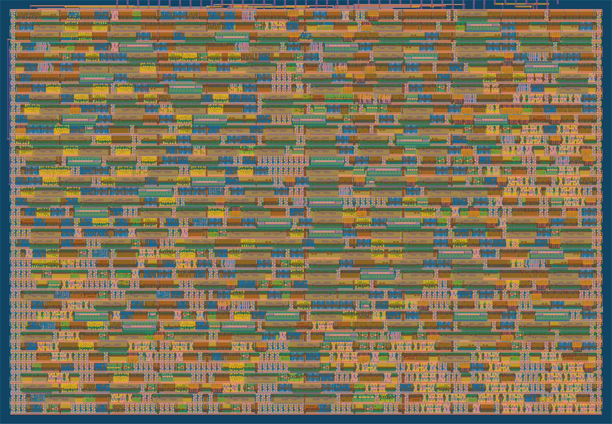

# 8 MACs per clock in one Tiny Tapeout tile



**[Try it in the browser: draw a digit and switch between 4, 2 and 1 bit pixels](https://joonsense.github.io/tt-int4-dot-accelerator/)**

A weight stationary dot product accelerator for a single 1x1 [Tiny Tapeout](https://tinytapeout.com) tile
(161 x 111.5 um, SkyWater sky130). 4 bit weights stay on chip; every input byte carries **eight 1 bit activations**,
so the chip does **8 multiply accumulates per clock** through the same 8 data pins.

Designed, formally checked, laid out and verified by an AI agent pipeline, hardened for free on GitHub Actions.
**It has not been fabricated.** Every number below is measured on the RTL, the post layout gate netlist, or the layout reports.

## Numbers

| | |
|---|---|
| Throughput | 8.0 MAC per clock (16 MACs per 2 clock vector, back to back, measured sustained in cocotb) |
| Area | 1x1 tile, 82.5% placement utilization |
| Timing | 50 MHz, setup slack +5.52 ns at the slow corner (ss, 100C, 1.60V) |
| Signoff | DRC 0, LVS 0, antenna 0, Tiny Tapeout precheck passed |
| Gate level tests | 7/7: protocol and sustained interval, host driver, long dot products, 400 vectors with 20 weight reloads under random stalls and backpressure, chained dot products of 1 to 40 vectors, abort and reset recovery, the digit classifier |
| Fault check | the same tests on a deliberately broken build fail |
| Formal | k-induction proof that a result is never dropped from the output queue, whatever the host does with OUT_READY |
| Power (estimate) | about 1.05 mW at 50 MHz, typical corner (LibreLane report) |

## The pins are the limit, so precision is the lever

A tile has 8 data input pins. Once the weights live on chip, MAC per clock is just how many activations fit in a byte.
Same tile, same pins, same flow:

| Design | MAC per clock | Utilization | ss slack | Digits accuracy | Chip clocks for 360 digits |
|---|---|---|---|---|---|
| [UART, INT8](https://github.com/Joonsense/tt-uart-dot-accelerator) | about 0.005 | 65.5% | +5.14 ns | | |
| [Pins, INT8, chained](https://github.com/Joonsense/tt-pin-dot-accelerator) | 0.5 | 61.8% | +7.13 ns | 95.83% | 482,400 |
| Pins, INT4, chained | 1.0 | 52.6% | +7.09 ns | 95.56% | 252,000 |
| [INT4 weights stationary](https://github.com/Joonsense/tt-int4-dot-accelerator) | 2.0 | 76.9% | +9.43 ns | 95.56% | 115,760 |
| INT4 weights x 2 bit activations | 4.0 | 73.1% | +6.29 ns | 95.28% | 58,120 |
| **INT4 weights x 1 bit activations (this repo)** | **8.0** | **82.5%** | **+5.52 ns** | **91.39%** | **29,320** |

Why activations and not weights: before building anything, the same digits layer was quantized every way.
Weights cut to ternary or binary dropped accuracy to 88.9% and 58.1%. Activations cut to 2 bits cost 0.3 points.
In a weight stationary design only activations cross the pins, so that is exactly the bit budget that buys throughput.

Every digit result above is 3,600 dot products bit identical to Python. The 2 bit design passed the same
Tiny Tapeout CI flow and gate level tests; this repo carries the 1 bit one.

## Pins

| Pin | Direction | Function |
|---|---|---|
| `ui_in[7:0]` | in | data byte: weight byte (two INT4, low nibble first) when LOAD = 1, else eight 1 bit activations, first in bit 0 |
| `uio[0]` | in | IN_VALID |
| `uio[1]` | in | ABORT (discard partial vector, set ERR) |
| `uio[2]` | in | OUT_READY |
| `uio[3]` | in | CHAIN (carry the 20 bit sum into the next vector) |
| `uio[4]` | out | IN_READY |
| `uio[5]` | out | OUT_VALID |
| `uio[6]` | in | LOAD |
| `uio[7]` | out | ERR |
| `uo_out[7:0]` | out | result, 2 bytes, least significant first, 16 bit saturated |

Full protocol: [docs/info.md](docs/info.md). Host drivers: `host/pin_client.py` (MicroPython, demo board, `act_bits=1`)
and `host/pio_stream.py` (RP2040/RP2350 PIO, co simulated, not yet run on hardware).

## Run the tests

```
cd test
pip install -r requirements.txt
make        # RTL: protocol, host driver, stress, digits
```

Tile and timing prediction for your own Tiny Tapeout project, calibrated on these layouts:
[tt-fit](https://github.com/Joonsense/tt-fit).
Write up: [kaikimlabs.com](https://kaikimlabs.com/research/experiments/ai-agent-chip-design-on-free-tiny-tapeout-flow/).

License: Apache 2.0. Built with the [Tiny Tapeout](https://tinytapeout.com) template and flow.
